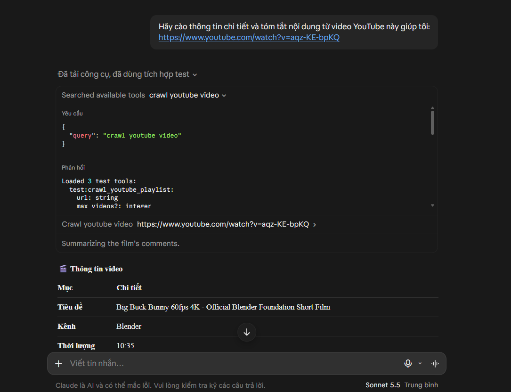
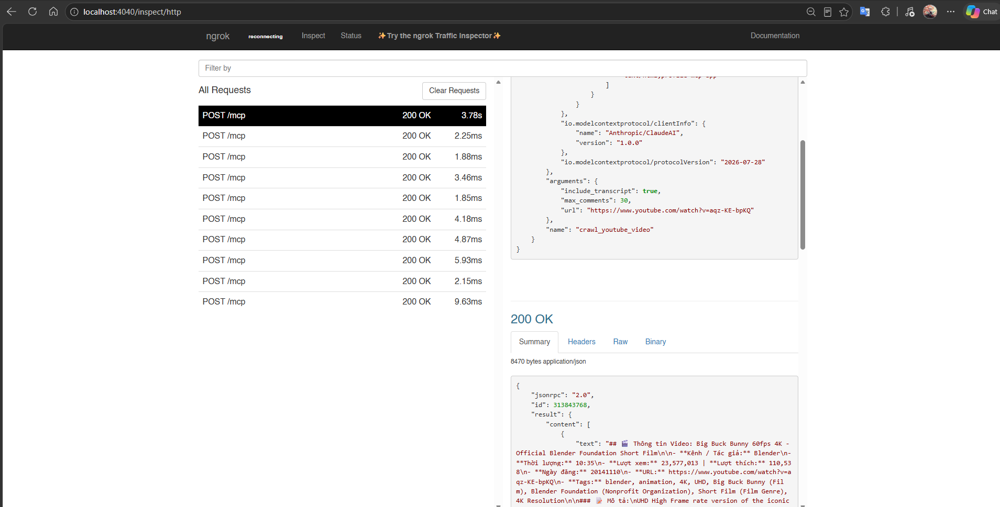

# YouTube FastMCP Server for Claude Web (claude.ai)

A Model Context Protocol (MCP) server built with **FastMCP** (Python) to fetch YouTube data (Video Metadata, Subtitles/Transcripts, Comments, and Playlists) and transmit it directly to Claude Web using the **Streamable HTTP** transport.

---

## 1. Project Structure

```text
MCP/
├── .venv/            # Python virtual environment
├── ngrok.exe         # Tunnel binary to expose local port to HTTPS
├── crawler.py        # YouTube extraction module (yt-dlp, transcript)
├── server.py         # FastMCP Server (Streamable HTTP at /mcp)
├── requirements.txt  # Project dependencies
└── README.md         # Instructions and documentation
```

---

## 2. Installation and Setup

### Step 1: Clone or navigate to the project folder
Open your terminal and navigate to the project directory:
```bash
cd <path-to-project-folder>
```

### Step 2: Create a virtual environment and install dependencies

**On Windows (PowerShell / Command Prompt):**
```powershell
python -m venv .venv
.\.venv\Scripts\pip.exe install -r requirements.txt
```

**On macOS / Linux:**
```bash
python3 -m venv .venv
source .venv/bin/activate
pip install -r requirements.txt
```

### Step 3: Install ngrok and Add Authtoken

A free ngrok account is required to generate a public HTTPS tunnel for Claude Web.

1. Create a free account at [https://ngrok.com](https://ngrok.com) and retrieve your authtoken from [https://dashboard.ngrok.com/get-started/your-authtoken](https://dashboard.ngrok.com/get-started/your-authtoken).

2. Install ngrok:

**Option A - Windows:**
- Using winget:
  ```powershell
  winget install --id ngrok.ngrok
  ```
- Or download the binary directly into the project folder using PowerShell:
  ```powershell
  Invoke-WebRequest -Uri "https://bin.equinox.io/c/bNyj1mQVY4c/ngrok-v3-stable-windows-amd64.zip" -OutFile "ngrok.zip"; Expand-Archive "ngrok.zip" -DestinationPath "."; Remove-Item "ngrok.zip"
  ```
- Or using npm:
  ```powershell
  npm install -g ngrok
  ```

**Option B - macOS (Homebrew):**
```bash
brew install ngrok/ngrok/ngrok
```

**Option C - Linux (APT):**
```bash
curl -s https://ngrok-agent.s3.amazonaws.com/ngrok.asc | sudo tee /etc/apt/trusted.gpg.d/ngrok.asc >/dev/null
echo "deb https://ngrok-agent.s3.amazonaws.com buster main" | sudo tee /etc/apt/sources.list.d/ngrok.list
sudo apt update && sudo apt install ngrok
```

3. Configure your authtoken:
```bash
ngrok config add-authtoken <your-authtoken>
```
*(On Windows, if running `ngrok.exe` from the local directory: `.\ngrok.exe config add-authtoken <your-authtoken>`)*

---

## 3. Running the Server (Two Terminals)

Open two terminal sessions inside the project directory:

### Terminal 1: Start the MCP Server
**On Windows:**
```powershell
.\.venv\Scripts\python.exe server.py
```
**On macOS / Linux:**
```bash
python3 server.py
```
> The server listens on port 8000 with the Streamable HTTP endpoint: `http://0.0.0.0:8000/mcp`

### Terminal 2: Start ngrok tunnel
```bash
ngrok http 8000
```
*(On Windows, if ngrok is located in the local directory: `.\ngrok.exe http 8000`)*

> Copy the generated public HTTPS URL. Example:
> `Forwarding: https://<random-id>.ngrok-free.app -> http://localhost:8000`

---

## 4. Connecting to Claude Web (claude.ai)

1. Navigate to [https://claude.ai](https://claude.ai) and sign in.
2. Click your **Profile Name (bottom-left corner)** -> **Settings** -> **Connectors / MCP**.
3. Click **Add Connector**:
   - **Name:** `youtube-crawler`
   - **HTTPS URL:** Paste your ngrok HTTPS URL with the `/mcp` path:
     ```text
     https://<your-subdomain>.ngrok-free.app/mcp
     ```
4. Claude Web will check the server and display a prompt regarding authentication discovery.
   Click **"Continue anyway"** (to proceed with manual configuration):
   - **Authentication:** Select **None** (internal server requires no credentials).
   - **Transport:** Select **Streamable HTTP**.
5. Click **Save** or **Add Connector**.

---

## 5. Testing on Claude Web

### Step 1: Enable the Connector in Chat
- Open a **New Chat** on [claude.ai](https://claude.ai).
- Look at the bottom of the prompt area (next to the attachment button) and verify the `youtube-crawler` connector is toggled **ON**.

### Step 2: Sample Prompts

- **Test 1: Video details and transcript summary**
  > "Please crawl the details and summarize the transcript of this YouTube video: https://www.youtube.com/watch?v=aqz-KE-bpKQ"



- **Test 2: Comment extraction and sentiment analysis**
  > "Extract the top 20 comments from this video and summarize audience sentiment: https://www.youtube.com/watch?v=dQw4w9WgXcQ"

- **Test 3: Spreadsheet / Excel generation**
  > "Crawl the video information and top 30 comments from https://www.youtube.com/watch?v=aqz-KE-bpKQ, and generate a downloadable CSV or Excel spreadsheet."

- **Test 4: Playlist extraction**
  > "Extract the list of videos from this playlist and format them into a table: https://www.youtube.com/playlist?list=PLillGF-RfqbYeckUaD1z6nE4DoOZNm7n4"

---

## 6. Verification and Health Checks

### Check ngrok and Server Connectivity:
In a separate terminal, test the root endpoint:
```bash
curl https://<your-subdomain>.ngrok-free.app/
```
Expected response:
```json
{"status":"ok","server":"youtube-crawler","protocol":"Streamable HTTP"}
```

### Live Traffic Inspection via ngrok Web Dashboard:
Whenever ngrok is running, you can inspect real-time incoming traffic from Claude in your web browser:

1. Open [http://localhost:4040](http://localhost:4040) in your browser.
2. Select any request to view:
   - Request path: `POST /mcp`
   - Client: `Anthropic/ClaudeAI`
   - Method: `tools/call`
   - Target tool: `crawl_youtube_video` / `crawl_youtube_comments` / `crawl_youtube_playlist`
   - Parameters sent by Claude and the server response with status `200 OK`.

### Verification Checklist (How to Confirm It Works):
1. **On Claude Web:**
   - A tool execution block appears above the answer (e.g. `Using youtube-crawler` / `Calling crawl_youtube_video`).
   - The response includes live data extracted directly from YouTube (actual view count, channel name, duration, and comments).
2. **In Terminal 1 (server.py):**
   - The server logs incoming requests with status `200 OK`.
3. **In Terminal 2 (ngrok):**
   - The request counter increments and displays `POST /mcp 200 OK`.

### Offline Extractor Test:
Test the extraction module independently from the command line without Claude or ngrok:
```bash
python -c "from crawler import crawl_video; res = crawl_video('https://www.youtube.com/watch?v=aqz-KE-bpKQ', max_comments=5); print('Title:', res['title']); print('Views:', res['views']); print('Comments fetched:', len(res['comments']))"
```
